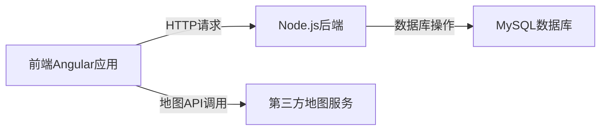

# 外部依赖说明

## 下游服务概述
本项目依赖以下外部服务和库：

| 依赖名称 | 用途 | 版本要求 |
|----------|------|----------|
| Angular | 前端框架 | 15+ |
| Express | 后端Web框架 | 4.18+ |
| MySQL | 数据库存储 | 8.0+ |
| Node.js | 后端运行时 | 18+ |
| JSON Web Tokens | 用户认证 | 9.0+ |
| 第三方地图API | 物品位置展示 | 未指定 |
| Axios | HTTP客户端 | 1.5+ |
| Body-parser | 请求体解析 | 1.20+ |

## 调用关系图

## 依赖说明
### 前端依赖
- **Angular框架**：核心前端框架，提供组件化开发能力
- **HTTP客户端**：用于与后端API通信
- **地图集成**：通过第三方地图API展示物品位置

### 后端依赖
- **Express框架**：提供RESTful API服务
- **MySQL驱动**：连接和操作MySQL数据库
- **JWT认证**：处理用户身份验证和授权
- **Body-parser**：解析HTTP请求体

### 部署依赖
- **Docker**：容器化部署（通过项目中的Dockerfile可见）
- **Node.js环境**：后端运行环境

## 外部服务集成
- **地图服务集成**：前端通过MapService调用第三方地图API展示物品位置
- **数据库服务**：后端通过MySQL驱动连接外部数据库服务

