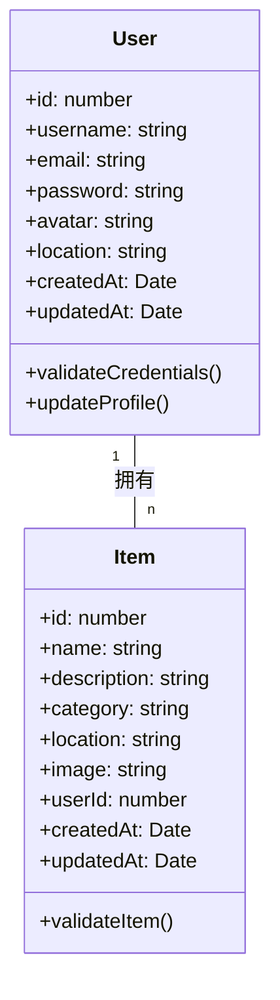

# 领域模型说明

## 领域模型概述
本系统核心业务概念包括用户(User)和物品(Item)，围绕用户管理、物品管理和位置服务展开。用户可注册登录、管理个人资料，创建和管理物品条目，并通过地图查看物品位置。

## 核心实体关系图

## 关键业务场景下的模型交互
1. 用户注册：创建User实体，验证唯一性
2. 物品添加：创建Item实体，关联User实体
3. 物品搜索：基于名称/分类查询Item实体
4. 用户物品列表：通过User ID获取关联Item实体

## 数据流转关系
- 用户数据：注册 → 存储 → 登录验证 → 资料管理
- 物品数据：创建 → 存储 → 搜索/编辑 → 展示
- 位置数据：物品位置存储 → 地图展示

## 实体属性详细说明
### User 用户实体
| 属性名 | 类型 | 说明 |
|--------|------|------|
| id | number | 用户唯一标识 |
| username | string | 用户名，长度限制：3-20字符 |
| email | string | 邮箱地址，格式验证 |
| password | string | 加密存储的密码 |
| avatar | string | 头像图片路径 |
| location | string | 用户位置信息 |

### Item 物品实体
| 属性名 | 类型 | 说明 |
|--------|------|------|
| id | number | 物品唯一标识 |
| name | string | 物品名称，必填 |
| description | string | 物品描述 |
| category | string | 物品分类 |
| location | string | 物品位置坐标 |
| image | string | 物品图片路径 |
| userId | number | 关联用户ID |

